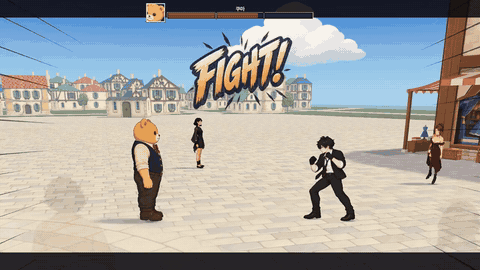

# ODDBOUT · AI Fighter Creator

**English** | [한국어](README.ko.md)

**Create a fighter with AI. Bring your character into the arena.**

ODDBOUT is a fighting game where you play with a character you create. This repository contains the open-source tools for making that character. Work with an AI assistant to turn a description or reference image into artwork, animations, and a fighter package for the game. The tools and docs also use the name AI Fighter.

[Play ODDBOUT](https://oddbout.com/fighter.html) · [Manage your fighters](https://oddbout.com/creator.html?lang=en) · [Creation guide](START-HERE.md) · [Report a problem](https://github.com/jeonghwanko/ai-fighter-dots-starter/issues)

## Gameplay preview

[](docs/media/oddbout-gameplay.mp4)

Existing ODDBOUT gameplay. The subscription-based character creation workflow is still experimental; this clip does not show a complete creation run.

[Watch the 10-second clip](docs/media/oddbout-gameplay.mp4) · [Play ODDBOUT](https://oddbout.com/fighter.html) · [Questions and feedback](https://github.com/jeonghwanko/ai-fighter-dots-starter/discussions)

## What you can make

- Start with a short idea, reference images, or both.
- Review the artwork and animations with your assistant. Ask to change what you do not like while keeping the versions you have chosen.
- Build a package with all 11 required motions, check the files, and register it with your account.
- Play with your registered fighter directly or let the common AI controller take over.

The kit includes sprite-gen, creation workflows, validation tools, and an MCP server for connecting your assistant to the game. The game engine is maintained separately.

## Register from Dots without a PC

Connect the hosted **ODDBOUT** MCP in ChatGPT Plugins, sign in with Google, then select
`@ODDBOUT` in your Dots conversation. The cloud connector handles account checks,
file transfer and registration; no local MCP installation, API key or callback copying is needed.
See [cloud connection instructions](https://github.com/jeonghwanko/ai-fighter-dots-starter/blob/97890ddf399cbbaae9351ee6d11ac0776714d7b0/docs/CLOUD-MCP.md) for the endpoint and first-time setup.
Image generation, previews and package review still use the selected host and your own generation account.
The setup below is for running the creation kit in a workspace; it is not required to authenticate the cloud connector.

## Create with the local kit

Send the [start link](START-HERE.md) to a new chat with an assistant that can run local commands and access files, such as a supported Dot, Codex, or Claude setup. Add an idea or a reference image. For example:

> Make a cat boxer in blue armor for ODDBOUT using this kit.
> Show me the concept first so we can get the appearance right.
> Then show me movement, attacks, and reactions in groups for feedback.
> When I choose the final result, validate it, register it with my account, and check that I can use it in the game.

Your assistant handles setup, generation, packaging, and file checks. You choose how the character looks and moves. Local creation can begin before you sign in to ODDBOUT.

### What you need

| Requirement | Details |
| --- | --- |
| A local execution environment | Your PC or a supported per-user workspace, with Git, Node.js **22.12+**, and Python **3.11+**. Your assistant can help with setup. |
| Your own generation account | Image and motion generation use your own supported accounts and subscriptions. The assistant checks actual image/video access and preview delivery before starting. |
| A Google account for registration | Sign in when you want to upload and register your fighter. No invitation or manual approval is required. |

Using the local kit takes setup and several rounds of review. Time, usage limits, and costs depend on your provider and how many changes you make. You choose the provider with your assistant. Switching providers or using a paid API needs your agreement. A browser-only chat needs a connected execution environment for the full workflow.

### Make and review, one group at a time

| Group | What you review |
| --- | --- |
| Appearance | Full-body concept, idle pose, and a face close-up from the same artwork |
| Movement | Fighting stance, walk, and run at a consistent scale |
| Attacks | Combo, slam, and dash, including preparation and recovery |
| Defense and reactions | Block, hit, groggy, fall, and get-up poses |
| Final review | All 11 motions from the packaged files, plus the name, description, and portrait |

Your assistant shows you actual previews and waits for your feedback after each group. It revises the affected assets and keeps your other selections. You can also ask it to handle later groups on its own. Alongside file checks, the assistant reviews character consistency, movement, foot contact, and timing. You review the results before moving on.

See the [full creation workflow](https://github.com/jeonghwanko/ai-fighter-dots-starter/blob/97890ddf399cbbaae9351ee6d11ac0776714d7b0/docs/DOT-CREATION.md) for generation, revision, and packaging.

## Set up the saved Dots VM

Start with [one entry point](START-HERE.md). The environment preparer follows [the install recipe](deploy/dots-environment/README.md) once. In the prepared environment:

```sh
git clone https://github.com/jeonghwanko/ai-fighter-dots-starter.git
cd ai-fighter-dots-starter
node dots.mjs --install
```

Later requests run `node dots.mjs`. It checks and recovers the same pinned runtime and workspace. Grok device login is connected per user; no login is put into the saved image. The **0.5.5 candidate** is undergoing saved-VM acceptance and is not yet certified for complete creation. Main's historical 0.2.0 package is not used by this Dots entry point.

For PC creation and bundle setup, read the [pinned runtime guide](https://github.com/jeonghwanko/ai-fighter-dots-starter/blob/97890ddf399cbbaae9351ee6d11ac0776714d7b0/docs/ODDBOUT-PLUGIN.md). Execute that runtime's commands in its own checkout, not in this front-door checkout.

## Register and play

When you choose the final result and ask to register it, your assistant checks the package and helps you sign in with Google using the service settings included in the kit. You do not need to set up a backend or get service API keys.

The server checks your uploaded files before making your fighter available in the game. Your assistant then checks the result to confirm that the fighter is registered and ready to play. The queue can take time to process.

Open the [creator page](https://oddbout.com/creator.html?lang=en) with the same Google account to see your fighter. See [registration, limits, and profile edits](https://github.com/jeonghwanko/ai-fighter-dots-starter/blob/97890ddf399cbbaae9351ee6d11ac0776714d7b0/docs/OPEN-REGISTRATION.md) for details. Keep login links, callback URLs, and session files private.

## Help and contributions

If setup, generation, sign-in, registration, or gameplay fails, [open an issue](https://github.com/jeonghwanko/ai-fighter-dots-starter/issues) with the failing step, expected and actual behavior, error message, and tool version or commit. Exclude credentials and private files. For generation or upload timeouts, check existing requests and outputs before retrying.

Bug reports, clearer setup instructions, and reproducible examples are welcome. Read [AGENTS.md](https://github.com/jeonghwanko/ai-fighter-dots-starter/blob/97890ddf399cbbaae9351ee6d11ac0776714d7b0/AGENTS.md) before using an assistant to change this repository.

| Resource | Use it for |
| --- | --- |
| [Cloud connection](https://github.com/jeonghwanko/ai-fighter-dots-starter/blob/97890ddf399cbbaae9351ee6d11ac0776714d7b0/docs/CLOUD-MCP.md) · [Connection recovery](https://github.com/jeonghwanko/ai-fighter-dots-starter/blob/97890ddf399cbbaae9351ee6d11ac0776714d7b0/docs/CONNECTION-READINESS.md) | Google sign-in, account checks, and cloud registration |
| [Authoring guide](https://github.com/jeonghwanko/ai-fighter-dots-starter/blob/97890ddf399cbbaae9351ee6d11ac0776714d7b0/docs/AUTHORING.md) | Fighter files and the package contract |
| [Creation UX](https://github.com/jeonghwanko/ai-fighter-dots-starter/blob/97890ddf399cbbaae9351ee6d11ac0776714d7b0/docs/CREATION-UX.md) | Character intake, feedback, and version selection |
| [Game creation context](https://github.com/jeonghwanko/ai-fighter-dots-starter/blob/97890ddf399cbbaae9351ee6d11ac0776714d7b0/docs/GAME-CREATION-CONTEXT.md) | Current motions, controls, and timing |
| [Gait review](https://github.com/jeonghwanko/ai-fighter-dots-starter/blob/97890ddf399cbbaae9351ee6d11ac0776714d7b0/docs/GAIT-REVIEW.md) | Walk/run quality and contact evidence |
| [Execution environment](https://github.com/jeonghwanko/ai-fighter-dots-starter/blob/97890ddf399cbbaae9351ee6d11ac0776714d7b0/docs/EXECUTION-HOST.md) · [Preview delivery](https://github.com/jeonghwanko/ai-fighter-dots-starter/blob/97890ddf399cbbaae9351ee6d11ac0776714d7b0/docs/DELIVERY.md) | Account isolation, local execution, and actual media display |
| [Hosting](https://github.com/jeonghwanko/ai-fighter-dots-starter/blob/97890ddf399cbbaae9351ee6d11ac0776714d7b0/docs/CREATOR-HOSTING.md) · [Security](SECURITY.md) | Deployment and security boundaries |

Local development checks, after installing dependencies:

```sh
npm run spec:check
npm test
npm run validate -- examples/sparring-bot/fighter.json
npm run mcp:smoke
```

The sparring-bot example is a geometric test fixture. These checks do not generate or register a character. Running matches on a self-hosted service requires the separate production game engine bundle.

## License

The creator kit is [MIT-licensed](LICENSE). The bundled [sprite-gen](vendor/sprite-gen) submodule has its own Apache-2.0 LICENSE and NOTICE. Generation providers have their own account and usage terms.
