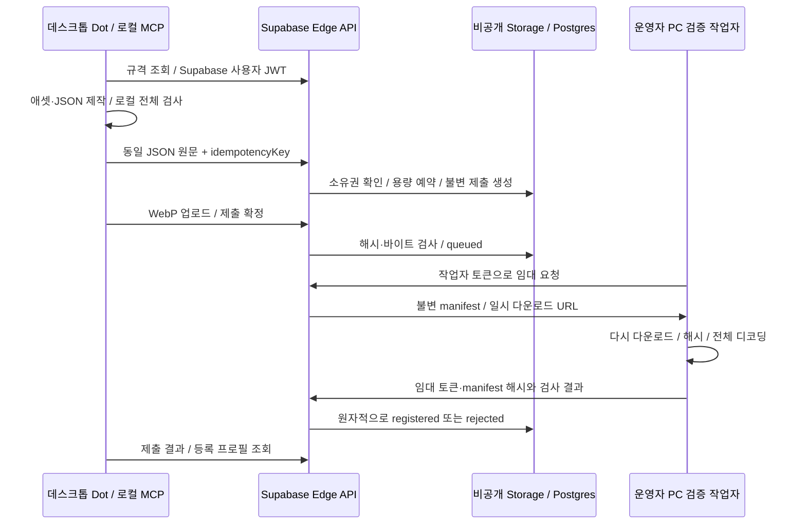

# 이전 초대 베타 운영 기록

> 이 문서는 이전 설계·시험 기록이다. 2026-10-21부터 초대와 사전 승인은 폐지했다. 현재 설치·등록·사후 조치는 [공개 이용 정책](OPEN-REGISTRATION.md)을 따른다. 아래 초대·승인 절차를 신규 사용자에게 적용하지 않는다.


v0.2는 초대된 사용자의 업로드 → 서버 파일 검사 → 선수 레지스트리 등록을 구현한다.
2026-10-19 기존 Free 프로젝트에서 실제 MCP로 예제 선수 1명을 등록했다.
등록은 데이터와 파일의 기술 검사 결과다. 새 등록은 runtimeApproved=false다.
운영자가 동일 manifest 해시의 플레이어 경기 범위를 승인하면 runtimeApproved=true와
runtimeScope=arena-player-v1을 반환한다. 승인된 Sparring Bot의 로컬 게임 출전을 확인했다.

## 구성과 상태



상태는 `uploading → queued → validating → registered | rejected`다.
업로드는 24시간 안에 끝낸다. 작업 임대는 5분이고, 중단된 작업은 최대 3회 시도한다.
같은 사용자·idempotencyKey·JSON 원문으로 재시도하면 기존 제출과 선수 ID를 반환한다.
같은 키에 다른 JSON을 보내면 409다. 수정한 패키지는 새 키로 제출한다.
24시간 안에 업로드를 끝내지 못한 제출은 같은 사용자의 다음 제출 생성 때 `rejected`(`upload-expired`)로 닫힌다.
그 전까지 조회 응답은 `uploading`에 `code: "upload-expired"`와 빈 `pending`을 함께 보인다.
현재 사용자당 등록 선수는 최대 3명이다. 새 선수는 `fighter` 없이 제출하며, 기존 선수 수정은 추가 등록 수를 차지하지 않는다. 등록한 선수는 `POST submissions?fighter=<id>`로 패키지를 제자리에서 교체한다. 선수 ID와 전적은 유지된다.

## 배포

원천 파일:

- [DB 마이그레이션](../supabase/migrations/20261019090136_ai_fighter_beta_registration.sql),
  [업로드 만료 수정](../supabase/migrations/20261020120000_ai_fighter_upload_expiry.sql),
  [안정성 수정](../supabase/migrations/20261020150000_ai_fighter_stability.sql)(둘 다 2026-10-20 운영 반영)
- [Edge 진입점](../supabase/functions/ai-fighter/index.ts), [공유 HTTP 처리기](../api/handler.mjs)
- [검증 작업자](../worker/run.mjs), [MCP 제출 도구](../mcp/remote-tools.mjs)

프로젝트 운영자만 마이그레이션을 적용한다. 새 테이블은 `af_` 접두사를 쓰고,
Storage bucket은 비공개 `ai-fighter-beta`다. 기존 게임 테이블·로그인·Storage 정책은 수정하지 않는다.
기존 프로젝트를 CLI에 연결할 때는 **그 프로젝트의 기존 마이그레이션 이력도 먼저 가져와 대조**한다.
이 샘플 하나만으로 기존 프로젝트에 `db reset` 또는 무검토 `db push`를 실행하지 않는다.

새 마이그레이션 작성 규칙(`test/migration-rules.test.mjs`가 검사한다):

- 함수를 바꾸면 `create or replace function` 전체를 다시 쓴다. `pg_get_functiondef` 결과를 `replace()`로 고치는
  방식은 쓰지 않는다. 결과 본문이 파일에 남지 않아 앞의 마이그레이션을 모두 따라가야 읽을 수 있다.
  이미 운영에 적용된 두 파일(`20261024022222`, `20261024104406`)만 예외다.
- 버전(앞 14자리)은 파일마다 하나다. `20261021090000`을 두 파일이 함께 쓰던 것을 2026-10-27에
  `20261021090001_ai_fighter_worker_dispatch.sql`로 바꿨다(순서 동일). 운영은 `db push`를 쓰지 않고 파일별로
  적용하므로 운영 DB에는 영향이 없다. 운영 이력을 맞추려면 `migration repair --status applied 20261021090001`이 필요하다.
- 함수 안의 `update`·`delete`는 `where`로 행을 고른다. 운영 API 역할(`authenticator`)은 `safeupdate`를 불러와 `where` 없는 문장을
  거부한다. 이관은 postgres로 돌아 이 실패를 보이지 않는다. 테스트의 PGlite는 확장을 불러올 수 없어 `migratedDatabase()`가
  Postgres의 구문 트리(`debug_print_parse`)로 같은 규칙을 함수·트리거 안 문장에 적용하고, 어긴 호출을 실패시킨다
  (`test/helpers/fighter-database.mjs`). 테스트가 부르지 않는 함수는 `test/migration-rules.test.mjs`의 정적 검사가 맡는다.
  한 행짜리 표도 `where singleton`처럼 적는다(2026-10-27 생성 워커 심장 박동이 모두 `database-unavailable`로 실패했다).

운영 `ai-fighter`는 게임 저장소의 배포 도구로만 올린다. plan의 변경 파일·현재 및 보관 엔진·대체할 운영 버전을 확인한 뒤 같은 옵션으로 배포한다:

```sh
npm run fighter:edge -- plan
npm run fighter:edge -- deploy --plan <id>
```

함수 파일 목록은 `edgeFiles`가 진입점의 import 그래프에서 만든다. 게임 배포 도구가 이 함수를 가져와 실제 엔진과 보관 엔진을 포함한다. `node scripts/edge-bundle.mjs --list`는 경로 확인만 가능하며 배포 payload를 만들지 않는다.
Deno import map에 없는 모듈(sharp, `node:` 모듈)을 Edge 코드가 import하면 목록 생성이 실패한다.
마이그레이션을 먼저, Edge 함수를 다음에, 작업자를 마지막에 반영한다.

**서버 대결을 운영할 때:** 게임 배포 도구가 `supabase/functions/ai-fighter/duel-engine.mjs`를 게임 원천에서 생성·검증한
순수 엔진 번들로 교체한다. 샘플에 있는 파일은 엔진 없는 설치에서 경기 저장을 503으로 막는 어댑터다. 이 체크아웃을 Supabase CLI/MCP나 수제 payload로 직접 배포하지 않는다.
게임 소스·원화는 이 공개 스타터에 포함하지 않는다. 기존 운영 함수에 빈 어댑터를 덮어쓰지 않는다.
게임의 `tools/ai-fighter/build-duel-engine.mjs`는 같은 공통 규칙·AI·타격 엔진을 번들로 만들며,
`simulateDuel(a, manifestA, b, manifestB, seed)`와 `engineVersion`을 내보낸다.
게임 엔진을 변경할 때는 버전을 올리고 서버·브라우저의 동일 결과 시험 후 함께 반영한다.

`verify_jwt = false`여도 등록 API는 사용자 JWT를 매 요청 검증하고 활성 초대를 확인한다.
검증은 `auth.getClaims`다. 프로젝트가 비대칭 JWT 서명 키를 쓰면 공개 키(JWKS, 캐시)로 Edge 안에서 검증하므로
Auth 서버 왕복이 없다. 대칭 키(기존 JWT secret)면 이전처럼 Auth 서버의 `getUser`로 검증한다.
로컬 검증은 만료 전 로그아웃을 보지 못한다. 등록 권한은 `af_creators` 초대를 끄면 즉시 막힌다.
작업자는 별도 토큰으로 인증한다. 승인 선수의 공개 조회와 서버 대결 요청은 게스트에게 허용한다.
게스트는 승인된 선수 ID 두 개와 재시도 키만 보낼 수 있다. 시드·승패·전적을 직접 쓰지 못한다.
Edge의 내장 `SUPABASE_URL`과 `SUPABASE_SERVICE_ROLE_KEY`만 DB·Storage의 권한 있는 쓰기에 사용한다.
서비스 키를 Dot·브라우저·클라이언트 세션 파일에 전달하지 않는다.
API 기본 경로는 `https://YOUR_PROJECT_REF.supabase.co/functions/v1/ai-fighter`다.

## 승인과 게임 로딩

[두 번째 마이그레이션](../supabase/migrations/20261019093527_ai_fighter_arena_runtime.sql)은 승인 상태를
`runtime_scope`, `runtime_manifest_sha`, `review_evidence`에 결합한다. 승인에는 동일 manifest 해시,
`arena-player-v1` 범위, 승인 사유와 검증 근거가 필요하다. 클라이언트의 직접 수정 권한은 없다.
일반 제출·작업자 검증만으로 출전 승인 상태가 되지 않는다. `/spec`의 runtimeApproved=false는 새 등록의 기본값이다.

운영자는 기술 검사를 통과한 패키지의 실제 경기 재생을 확인하고 해당 해시에만 승인 상태를 기록한다.
현재 범위는 플레이어 측 캐릭터의 외형이다. 직접 조종하거나 게임의 공통 AI가 같은 입력 함수를 호출한다.
체력·피해량·판정은 게임의 공통 플레이어 규칙이 소유한다. 외부 AI 호출 비용은 없다.
랭킹 밸런스·새 그림의 상용 품질을 승인하는 범위가 아니다. 등록 선수끼리의 대결은 별도 승인을 쓴다.

### 등록 선수끼리의 대결 승인

`duel_approved`는 기본 false다. true로 바꾸려면 기존 출전 승인, 동일 해시의 `duel_manifest_sha`,
검토 근거의 `duelValidation`이 모두 필요하다. 제작자는 이 필드를 변경할 권한이 없다.
목록과 패키지 API는 해시가 일치하는 경우에만 `duelApproved: true`를 반환한다.
게임은 입장 직전에 두 선수의 패키지를 다시 확인한다. 캐시가 있어도 승인이 취소된 선수는 출전하지 못한다.

로컬 게임에서 선수를 선택하고 **등록 선수 대결 · F9**를 누르면 승인된 다른 등록 선수와 매칭한다.
양쪽은 같은 기존 파이터 AI·튜닝을 사용하고, 실제 전투 판정이 결과를 낸다. 외부 AI 호출은 없다.
서버가 시드와 승인 패키지 해시를 고정하고 같은 전투 엔진으로 결과를 먼저 계산·저장한다.
브라우저는 서버 시드로 경기를 재생하고 결과 지문·승패·시간·접촉·체력을 대조한다.
재생 중 창을 닫거나 나가도 서버 결과는 유지된다. 불일치하면 서버 확정 결과를 표시한다.

[전적 마이그레이션](../supabase/migrations/20261019113808_ai_fighter_server_duels.sql)의 `af_duels`가 결과 원천이다.
POST /duels는 정확히 `{a, b, idempotencyKey}`만 받는다. 클라이언트가 시드·승자·결과를 보내면 422다.
동일 키·동일 순서의 두 선수로 재요청하면 같은 경기 ID와 결과를 반환한다. 다른 선수 조합이면 409다.
DB 고유 키와 트랜잭션 잠금이 동시 요청을 직렬화한다. 완료 결과를 다른 결과로 바꿀 수 없다.
승·패·승점은 완료 경기에서 집계하므로 별도 누적 카운터가 중복 증가하지 않는다.

GET /duels/:id는 완료 결과를, GET /rankings는 승인 선수 최대 20명의 승·패·승점·순위를 반환한다.
승리당 3점이며 승수가 같으면 패수가 적은 선수가 앞선다. 승·패가 모두 같으면 공동 순위다.
로컬 게스트 전적은 서버에 가져오지 않는다. 기존 주간 대회·상금은 계속 로컬 저장을 사용한다.
선수 선택 카드와 경기 결과 화면의 등록 선수 대결 전적은 서버 값을 사용한다.

무료 베타의 자체 상한은 UTC 기준 전체 100경기/일, 같은 두 선수 20경기/일, 보관 10,000건이다.
완료·진행 중인 경기가 상한에 포함되며 같은 키의 재시도는 추가 차감하지 않는다. 초과 시 429를 반환한다.
엔진 오류·잘못된 결과·패키지 불일치로 끝나지 못한 경기는 `failed_at`·`failure`가 기록되고 상한에서 빠진다.
같은 키로 다시 요청하면 다시 계산한다. 실패한 계산이 UTC 하루 20회가 되면 새 경기와 미완료 재시도를
503 `duels-failing`으로 멈춘다. 엔진을 고친 다음 날 다시 열린다. 운영자는 `af_duels.failure`로 원인을 본다.
`af_settings.paused`는 새 경기 예약도 중단한다. 이 상한은 기존 프로젝트의 모든 비용을 보장하거나
공개 서비스의 남용 방지를 대신하지 않는다. 현재는 소수의 승인 선수로 시험하는 베타다.

테스트용 두 번째 패키지를 만들고 Dot에 노출되는 실제 stdio MCP로 제출하는 예:

```powershell
node scripts/create-example.mjs output/challenger-bot challenger
$env:AI_FIGHTER_CLIENT_CONFIG = 'C:/private/ai-fighter/second-creator.json'
node scripts/submit-sample.mjs output/challenger-bot/fighter.json
```

다른 초대 제작자 세션이 필요하다. 제작자당 선수 1명 제한은 유지한다.
검증 작업자가 실행 중이어야 등록이 완료된다. 스크립트는 요청 키를 보존하므로 같은 명령의 재시도는 중복 등록하지 않는다.
등록 성공은 대결 승인을 뜻하지 않는다. 운영자는 검증한 해시에만 별도 승인한다.

게임 연결 흐름:

1. GET /roster로 승인된 선수 ID·이름·해시를 받는다. 소유자·제출·임대 정보는 목록에 포함하지 않는다.
2. GET /roster/:id로 같은 해시의 JSON 원문과 일시 파일 URL을 받는다.
3. JSON 원문의 SHA-256과 규격을 검사하고, 파일을 내려받아 바이트 수와 SHA-256을 확인한다.
4. 목록에는 정지 동작만 먼저 받고, 입장 때 승인 상태를 다시 조회한 뒤 나머지 동작을 준비한다.
5. 서버 ID로 목록·경기·전적을 연결한다. 같은 ID는 목록에 한 번만 표시한다.

위 선수 GET 경로와 경기·랭킹 API를 브라우저에 공개한다. 브라우저에는 서비스 키나 사용자 세션을 넣지 않는다.
승인 패키지의 그림은 공개 전달 대상이다. 버킷 자체는 비공개이며 URL은 10분 뒤 만료된다.
승인 취소는 신규 전달·입장을 막지만 이미 내려받은 그림과 진행 중인 경기를 회수하지는 않는다.

현재 게임 개발 환경의 설정은 다음과 같다. 프로젝트 주소는 운영자가 자신의 주소로 바꾼다.

```dotenv
VITE_AI_FIGHTER_API_BASE=https://YOUR_PROJECT_REF.supabase.co/functions/v1/ai-fighter
```

이 값은 공개 API 주소다. 비밀 키가 아니다. 미설정 또는 통신 실패 시 기존 게임 선수는 계속 사용할 수 있다.
게임 구현은 원본 게임 저장소에 있으며, 이 공개 샘플은 전달 API·DB·MCP·검증 작업자를 제공한다.

## Google 로그인

2026-10-21 운영 Supabase에 반영했다. migration `20261021090000_ai_fighter_access_requests.sql` 적용, Edge Function 재배포,
Auth 리다이렉트 주소 추가와 수동 계정 연결 켜기까지 끝났다. 운영 반영 기록은 아래 설계 문서 6절에 있다.
설계와 남은 단계는 게임 저장소의 `docs/Plan/2026-10-20-ai-fighter-google-login/README.md`가 소유한다.

- 사용자가 직접 로그인한다. 운영자가 세션 파일을 만들어 전달하지 않는다.
  ```sh
  AI_FIGHTER_SUPABASE_URL=https://YOUR_PROJECT_REF.supabase.co   AI_FIGHTER_PUBLISHABLE_KEY=YOUR_PROJECT_PUBLISHABLE_KEY npm run login
  ```
  `--url`, `--key`, `--port` 플래그도 쓸 수 있다. 두 번째 로그인부터는 기존 세션 파일의 공개 값을 다시 쓴다.
- `scripts/login.mjs`가 `127.0.0.1:47821/callback/<무작위 state>`에 임시 콜백을 열고 Google 로그인(PKCE)을 진행한다.
  state가 맞지 않는 요청은 404로 무시한다. 다른 로컬 페이지가 진행 중인 로그인을 끝내지 못한다.
  5분 안에 끝나지 않으면 닫는다. Google 계정 선택 화면을 항상 띄운다. 홈페이지와 같은 계정을 골라야 한다.
- 세션 파일에 다른 사용자의 세션이 있으면 덮어쓰지 않고 멈춘다(`session-user-differs`).
  운영자가 준비한 베타 세션이 유일한 사본일 수 있기 때문이다. 기존 계정이면 `--link`, 정말 바꾸려면 `--replace`를 쓴다.
- 키는 `sb_publishable_` 키나 `role`이 `anon`인 JWT만 받는다. 비밀 키와 `service_role` 키는 거부한다.
- 세션은 `~/.ai-fighter/client.json`(또는 `AI_FIGHTER_CLIENT_CONFIG`)에 위 형식 그대로 저장한다.
  `api/client.mjs`의 같은 잠금과 원자적 교체를 쓴다. 비밀 키는 받지 않는다.
- MCP는 `AI_FIGHTER_CLIENT_CONFIG`가 없으면 기본 경로를 찾는다. 파일이 없으면 로컬 도구만 노출한다.
  MCP가 실행 중일 때 처음 로그인했다면 호스트 앱을 다시 시작한다.
- 로그인은 Supabase 사용자를 만들 수 있다. 제출은 여전히 `af_creators` 초대가 필요하다.
  초대가 없으면 `GET /me`가 `invited: false`를 반환하고, 사용자는 `POST /access-requests`로 초대를 요청한다.
  운영자는 `af_access_requests`를 확인한 뒤 `af_creators`에 행을 추가하고 요청 상태를 `approved`로 바꾼다.
- `npm run logout`은 접근 토큰이 만료됐으면 먼저 갱신한 뒤 Supabase에서 이 세션을 끝내고 파일을 지운다.
  서버에서 끝내지 못하면 그렇게 알린다. 실행 중인 MCP는 메모리에 갱신 토큰을 갖고 있으므로 앱을 다시 시작한다.
- MCP는 `AI_FIGHTER_CLIENT_CONFIG`로 지정한 파일이 잘못되면 시작하지 않는다. 기본 경로의 파일이 잘못되면
  stderr에 한 줄을 남기고 로컬 도구만으로 시작한다.
- 기존 베타 계정(이메일/비밀번호)에 Google을 연결할 때는 그 계정의 세션 파일로 실행한다.
  `AI_FIGHTER_CLIENT_CONFIG=<기존-계정-client.json> npm run login -- --link`.
  Supabase Auth의 수동 연결(manual linking)이 켜져 있어야 한다. 연결 후 사용자 ID가 바뀌면 파일을 바꾸지 않고 멈춘다.
  그 Google 계정으로 먼저 로그인해 별도 사용자가 생겼으면 `identity-already-linked`로 멈춘다.
- 운영 반영에 필요한 설정: Supabase Auth 리다이렉트 허용 목록에 `http://127.0.0.1:47821/**`을 추가한다.
  다른 포트를 쓰면 그 주소도 추가한다.
- 초대 요청이 거절되면 7일 동안 다시 요청할 수 없다(`request-declined`, 409). 그 뒤에는 다시 대기 상태로 열 수 있다.
  동시에 들어온 첫 요청 두 개는 한 행으로 합쳐진다.

## 베타 계정과 Dot 연결

이번 베타는 Supabase Auth의 사용자 세션을 사용한다. 기존 게임 계정 연결은 후속 구현이다.
운영자가 Auth에 존재하는 사용자 ID를 `af_creators`에 초대한다. 기본 만료는 30일이다.
공개 OAuth 설치·로그인 UI는 아직 없다. 완성된 원클릭 온보딩이라고 안내하지 않는다.

운영자가 준비한 **사용자 자신의** 세션을 다음 비공개 파일에 저장한다.
파일은 저장소 밖에 두고 해당 OS 계정만 읽을 수 있게 한다. 사용자에게 서비스 키를 발급하지 않는다.

```json
{
  "url": "https://YOUR_PROJECT_REF.supabase.co",
  "publishableKey": "YOUR_PROJECT_PUBLISHABLE_KEY",
  "accessToken": "USER_ACCESS_TOKEN",
  "refreshToken": "USER_REFRESH_TOKEN"
}
```

MCP는 유효한 접근 토큰을 추가 인증 요청 없이 다시 쓴다. 만료 60초 전부터 세션을 갱신한다.
갱신한 세션은 임시 파일에 쓴 뒤 같은 파일로 바꿔 넣는다. 저장이 중간에 끊겨도 기존 파일이 깨지지 않는다.
여러 MCP 프로세스(데스크톱 앱·CLI·IDE)가 같은 파일을 쓸 수 있다. Supabase는 두 번 전의 refresh token을
다시 쓰면 세션 전체를 끝낸다. 그래서 갱신 전에 파일을 다시 읽어 다른 프로세스가 저장한 새 세션을 쓰고,
`<파일>.lock`을 잡은 프로세스 하나만 갱신한다. 30초 넘은 잠금은 비정상 종료의 흔적으로 보고 지운다.
업로드·다운로드 제한 시간은 30초에 64 KiB당 1초를 더한다.
갱신이 취소되었으면 다시 로그인해야 한다.
검증용 두 계정과 작업자 토큰을 만드는 스크립트는
[provision-test-accounts.mjs](../scripts/provision-test-accounts.mjs)다.
이는 테스트 계정용 운영자 도구이며 일반 사용자 로그인 기능이 아니다.
운영자 환경 변수 `SUPABASE_URL`, `SUPABASE_SECRET_KEY`, `SUPABASE_PUBLISHABLE_KEY`,
`AI_FIGHTER_PRIVATE_DIR`가 필요하다. 출력 폴더는 새 폴더여야 하며 이 스크립트를 MCP에 연결하지 않는다.
Windows에서는 폴더의 상속 ACL도 제거하고 현재 OS 계정만 접근하도록 설정한다.

```powershell
$env:AI_FIGHTER_CLIENT_CONFIG = 'C:/private/ai-fighter/client.json'
node scripts/print-install.mjs
# 출력된 codex mcp add 명령 실행 후 새 로컬 대화를 연다.
```

Dot에서 첫 실제 등록:

> ai-fighter 규격을 읽고 examples/sparring-bot/fighter.json을 검사해줘.
> UUID 하나를 idempotencyKey로 정해서 submit_fighter_package로 제출해.
> 재시도할 때는 같은 키를 사용하고 get_fighter_submission으로 결과를 조회해.
> 등록되면 get_registered_fighter로 이름과 ID, 실제 경기 출전 승인 여부를 알려줘.

공식 MCP SDK의 stdio 연결과 실제 원격 쓰기는 시험했다. 사용자별 Dot 화면의 도구 노출은 자동 시험하지 않았다.
같은 호스트의 새 로컬 대화에서 도구가 보이지 않으면 앱을 다시 시작한다.
웹 ChatGPT용 공개 HTTP MCP·OAuth 배포는 이 로컬 연결과 별도다.

## 제작자 홈페이지 연결 링크

`open_creator_homepage`는 `POST /creator-handoffs`로 이 계정 전용 일회용 토큰을 받아
`https://jeonghwanko.github.io/ai-fighter-dots-starter/creator.html#handoff=<tokenHash>` 링크를 만든다. 어느 기기의 브라우저에서나 열린다.
홈페이지는 무료 GitHub Pages에서 제공하고 기존 Supabase를 사용한다. [호스팅·재배포 안내](CREATOR-HOSTING.md)를 따른다.

- 서버는 `auth.admin.generateLink({ type: 'magiclink' })`로 토큰을 만든다. 메일은 보내지 않으며 해시만 돌려준다.
  발급된 토큰의 사용자 ID가 요청한 사용자와 다르면 거부한다. 이메일이 없는 계정은 `handoff-email-required`(422).
- 페이지는 [내 선수 보기]를 누를 때 브라우저에서 `POST /auth/v1/verify`로 토큰을 쓴다. 접근 토큰만 탭에 보관하고
  갱신 토큰은 버린다. Edge Function이 대신 verify하지 않는 이유는 Auth의 IP별 검증 한도를 모든 사용자가 나눠 쓰게 되기 때문이다.
- 한 번만 쓸 수 있고 만료는 Auth가 강제한다. **Auth의 Email OTP expiration을 600초로 둔다.**
  `api/creator-link.mjs`의 `HANDOFF_TTL_SECONDS`(링크에 표시하는 만료 시각)와 같은 값이어야 한다. 같은 설정이 이메일 OTP 로그인에도 적용된다.
- 링크는 해시(`#`)에 토큰을 담아 서버 로그와 링크 미리보기 요청에 실리지 않는다. 클릭 한 번을 요구해 링크 검사기가 먼저 소비하지 못하게 한다.
- 이전 MCP가 만든 loopback 링크(`#dot=…&port=…`)는 페이지가 당분간 계속 받는다. 새 MCP는 만들지 않는다.
- 배포 순서: Edge Function → Auth OTP 만료 600초 → 홈페이지 → 이 저장소 공개. 홈페이지가 `#handoff`를 받기 전에 새 MCP를 공개하지 않는다.
- 운영 반영(2026-10-20): Edge Function 11판(이 코드 + 운영 엔진 번들 `standard-duel-2026-10-19-v1`, 빈 어댑터 미배포)과
  Auth Email OTP 만료 600초를 사용자가 직접 반영했다. 배포 전후 `/spec`·`/rankings`·`/roster` 응답이 바이트 단위로 같았고,
  인증 없는 `POST /creator-handoffs`는 401, `GET`은 405다. 실제 Dot 세션으로 링크를 발급해 로컬 홈페이지에서 [내 선수 보기]로
  로그인했고(탭에는 접근 토큰 하나만), 같은 링크를 다시 쓰면 만료 안내가 나왔다. 600초 경과 만료 자체는 따로 기다려 확인하지 않았다.

## API 계약

| 메서드·경로 | 인증 | 역할 |
| --- | --- | --- |
| GET /spec | 없음 | 서버 규격·베타 등록 가능 여부 |
| GET /roster | 없음 | 출전 승인된 선수의 ID·이름·해시·범위. 최대 20명. 운영자가 목록에서 뺀 선수(`af_fighters.listed = false`)는 빠진다. 클라우드 MCP로 만든 선수는 `madeWith`(만든 에이전트) |
| GET /roster/:id | 없음 | 승인된 JSON 원문과 10분 만료 다운로드 URL. 목록에서 뺀 선수도 준다 |
| POST /duels | 공개 게스트 요청 | 승인된 두 선수의 서버 계산·저장. a, b, idempotencyKey만 허용 |
| GET /duels/:id | 없음 | 확정된 경기의 ID·시드·해시·엔진 버전·결과 |
| GET /rankings | 없음 | 승인 선수별 승패·점수·공동 순위. 최대 20명 |
| POST /submissions | 사용자 JWT + 초대 | JSON 원문 접수, UUID Idempotency-Key 헤더 필수 |
| PUT /submissions/:id/assets/:assetId | 소유자 | image/webp 바이너리, 선언 크기·해시 일치, 덮어쓰기 금지 |
| POST /submissions/:id/submit | 소유자 | 모든 파일 존재·크기 확인 후 검증 큐에 넣기 |
| GET /submissions/:id | 소유자 | 상태·오류·선수 ID 조회 |
| GET /fighters/:id | 소유자 | 등록 프로필·검토 상태 조회 |
| GET /me | 사용자 JWT (초대 불필요) | 초대 여부·만료 시각·초대 요청 상태 |
| POST /access-requests | 사용자 JWT (초대 불필요) | 베타 초대 요청. 선택 `note` 500자 이하, 사용자당 1건, 24시간 3회 |
| POST /creator-handoffs | 사용자 JWT (초대 불필요) | 제작자 홈페이지 일회용 로그인 토큰 해시(`tokenHash`)와 만료 시각. 본문은 읽지 않는다 |
| GET /story/:id | 없음 | 공방과 연대기(4단계): 공개 선수의 정본(지금 판, `?version=`), 판 목록, 공방 글 20개(`?before=`로 앞), 맺은 관계 |
| PUT /fighters/:id/canon | 소유자 | 정본 다음 판 `{ base, sheet }`. 읽은 판이 아니면 409 `canon-changed` |
| POST /notes · DELETE /notes/:id | 사용자 JWT | 공방 글 쓰기(공개 이름 필요)·거두기(글쓴이) |
| POST /notes/:id/resolve | 소유자 | 제안 받기·거절 `{ decision }`(거절은 비평·경기평도 치운다). 정본 칸은 데이터베이스가 그때의 정본 위에 합친다 |
| POST /relations · POST /relations/:id/answer · DELETE /relations/:id | 사용자 JWT | 관계 맺기·받기·끊기 |
| GET /me/workshop · PUT /me/name | 사용자 JWT | 받은 공방 글(최근 100개)·관계(`otherKind`)·내 선수의 지금 정본(`canon`)과 공개 이름 |
| GET /worlds · GET /worlds/:id | 없음 | 공개 세계 목록·표지, 세계 하나(진영·소속 선수·정사) |
| POST /worlds · PATCH /worlds/:id · POST /worlds/:id/posts | 사용자 JWT | 세계 열기(계정당 둘)·고치기(진영·정사·선수 빼기)·라운지 글(그 사람으로) |
| PUT /fighters/:id/world | 소유자 | 선수를 남이 연 세계·진영에 두기, `world: null`이면 빼기 |
| GET /generations/capabilities | 없음 | 호스팅 생성(2026-10-27): 지금 신청을 받는지(`hosted`)와 이유·대기 작업 수 |
| GET /generations · POST /generations · POST /generations/uploads | 사용자 JWT | 내 최근 생성 작업 다섯과 무료 사용 여부, 신청(`Idempotency-Key`, 설명·언어·그림 id·권리 확인), 참조 그림 올리기(PNG·JPG·WebP, 4 MB) |
| GET·DELETE /generations/:id · POST /generations/:id/appearance·motions·register | 사용자 JWT | 작업 읽기(그림은 10분 서명 URL)·취소, 외형 고르기·수정, 동작 수정, 프로필 확인과 등록 |
| POST /generation-worker/heartbeat·claim·progress·finish · PUT /generation-worker/jobs/:id/artifacts/:name · /generation-worker/jobs/:id/submission… | 생성 작업자(`scope = generation`) | 심장 박동·임대·연장·단계 결과, 후보·미리보기 그림, 신청자 계정으로 패키지 제출 |
| POST /worker/claim | 작업자 | 큐 임대·일시 다운로드 URL 발급 |
| POST /worker/finish | 작업자 | 동일 임대·manifest 해시로 검사 확정 |

오류는 `ok: false`, `code` 및 필요한 경우 `errors`를 반환한다.
주요 HTTP 상태: 인증 없음 401, 초대·작업자 권한 없음 403, 다른 소유자·없는 자료 404,
불변성·용량·상태 충돌 409, 본문 초과 413, 잘못된 파일 종류 415, 규격·해시 오류 422,
사용자 요청 한도 429, 일시 서비스 오류 503.

## 검증 작업자 실행

Edge Functions의 CPU·네이티브 모듈 제약 때문에 sharp 전체 디코딩은 기존 개발 PC가 수행한다.
운영자는 임의 32바이트 토큰에 `afw_`를 붙이고 SHA-256만 `af_workers.token_hash`에 저장한다.
실제 토큰은 다음 비공개 설정 파일에만 둔다. 기본 작업자 만료는 30일이다.

```json
{ "url": "https://YOUR_PROJECT_REF.supabase.co", "workerToken": "afw_YOUR_64_HEX_DIGITS" }
```

```powershell
$env:AI_FIGHTER_WORKER_CONFIG = 'C:/private/ai-fighter/worker.json'
npm run worker:once
# 계속 운영할 때:
npm run worker:watch
```

작업자는 사용자 MCP와 별도 프로세스로 운영한다. 빈 큐 조회는 최대 120초 간격으로 늦춘다.
작업을 마치면 다음 작업을 바로 가져온다. 다운로드는 4개씩 받고 파일 크기에 비례한 제한 시간을 쓴다.
작업 전체는 4분 안에 끝낸다. 서버 임대 5분 안에 검사와 확정을 마치기 위해서다.

**판정과 인프라 실패를 구분한다.** 패키지 결함(계약 위반·해시·디코딩·빈 프레임)만 `rejected`로 확정한다.
다운로드 실패·저장소 바이트 불일치·작업 시간 초과·검사 프로세스 오류는 확정하지 않고 `retry-later`로 끝낸다.
작업자는 자기 임대로 `worker/release`(`af_release`)를 호출해 작업을 바로 대기열로 돌려준다. 이때 시도 횟수는
돌려주고 `infra_failures`만 하나 늘린다. 인프라 실패가 연속 10번이면 검사기를 매번 멈추게 하는 패키지로 보고
`worker-infrastructure-limit`로 반려한다. 돌려주기에 실패하면(옛 API·장애) 예전처럼 임대가 끝난 뒤 다시 가져가며
시도를 센다. 세 번 모두 실패하면 서버가 `worker-attempt-limit`로 반려한다.
따라서 일시적인 네트워크 오류가 제작자의 제출 횟수를 쓰지 않는다.

**검사기 버전.** 작업자는 `VALIDATOR_VERSION`을 영수증에 적고 서버는 `af_settings.validator_versions`에 있는 값만 받는다.
새 검사기를 배포할 때는 먼저 새 버전을 목록에 추가하고, 모든 작업자를 바꾼 뒤 옛 버전을 지운다.
결과가 즉시 나타나지 않을 수 있다. PC에서 실행하면 PC가 꺼진 동안 제출은 대기한다.
현재 운영은 [독립 무료 호스팅](CREATOR-HOSTING.md)의 Render Free 웹 작업자다.
Supabase가 대기 제출이 있을 때만 인증된 HTTP 요청으로 깨우고, 중단된 임대는 다시 시도한다.
기존 FindThem의 systemd 작업자는 중지·비활성화했다. [systemd 유닛](../deploy/ai-fighter-worker.service)은 별도 서버 운영을 위한 참고 예시다.
작업자를 옮길 때는 새 토큰 해시를 먼저 등록하고, 새 작업자가 큐를 정상 조회하는지 확인한 뒤 옛 작업자를 멈추고 옛 토큰을 끈다.
작업자 토큰은 큐를 검사·확정할 권한이다. 이를 Dot에 제공하지 않는다.

파일은 작업별 새 디렉터리에 다운로드한다. 해시·크기·전체 디코딩·프레임·crop을 다시 검사한다.
외부 URL 다운로드와 리디렉션은 허용하지 않는다. 자식 프로세스 검사 제한은 20초다.
V8 힙·픽셀 예산은 네이티브 메모리의 OS 강제 격리를 대신하지 않는다.
현재는 초대 베타이며 불특정 다수 공개 접수 전 OS 메모리·CPU 격리가 필요하다.

## 무료 운영 한도와 중단

앱 자체 상한은 활성 초대 20명, 사용자당 선수 1명·진행 중 제출 1개·누적 제출 5개,
패키지 10 MB, 단일 파일 4 MB, 사용자 요청 120회/분이다.
전체 제출 예약은 **100 MB**로 제한한다. 20명 모두 최대 10 MB를 제출할 수 있다는 보장은 아니다.
반려·만료 파일도 예약 용량에 포함한다. 기존 프로젝트의 다른 사용량은 별도 합산한다.

**호출자별 제한(2026-10-28).** 로그인 없는 경기 요청(`POST /duels`)과 기기 연결 시작(`POST /device-logins`)은
전체 한도(하루 100경기, 10분에 120회)만 있어 한 사람이 모두의 몫을 쓸 수 있었다. 이제 호출자 주소의 키 해시로
호출자별 제한(경기 하루 25회, 기기 연결 10분에 10회)을 둔다(`api/client-limit.mjs`, `af_rate_hits`).
주소 원문은 저장하지 않는다. 서버 비밀로 만든 HMAC-SHA256(구분·UTC 날짜·주소)만 하루 보관하고, 날짜가 들어가 날마다 다른 키가 된다.
첫 `X-Forwarded-For` 값은 클라이언트가 직접 쓸 수 있으므로 쓰지 않는다
([Supabase discussion #34647](https://github.com/orgs/supabase/discussions/34647)).

켜는 순서(모두 운영자 승인 후):

1. 마이그레이션 `20261028090000_ai_fighter_client_rate_limits.sql`을 적용한다.
2. 임시 함수 `client-ip-probe`를 배포하고 `node scripts/probe-client-ip.mjs https://<ref>.supabase.co/functions/v1/client-ip-probe`로
   위조 헤더를 보낸다. `trusted: true`인 출처만 쓴다. 확인 후 함수를 삭제한다.
3. Edge 비밀 `AI_FIGHTER_CLIENT_LIMIT_SECRET`(32자 이상 무작위)과 `AI_FIGHTER_CLIENT_IP_SOURCE`(`cf-connecting-ip` 또는
   `forwarded-last`)를 넣고 `ai-fighter` 함수를 배포한다. 둘 중 하나라도 없으면 제한은 꺼진 채로 전체 한도만 동작한다.
4. 개인정보 처리방침에 이 처리를 적는다(초안은 PR에 있다).

제한 기록 조회가 실패하면 요청을 막지 않고 전체 한도로 넘긴다.

2026-10-27 운영 반영: 마이그레이션 적용 뒤 프로브로 확인했다. 클라이언트가 보낸 `CF-Connecting-IP`는 Cloudflare가 403(`error code: 1000`)으로
막아 함수에 닿지 않는다. 함수가 받는 `CF-Connecting-IP`는 호출자의 공인 IP와 같았다. `X-Forwarded-For`는 호출자 IP 두 번과 내부 프록시
주소이고, 클라이언트가 보낸 값은 지워진다. 그래서 `forwarded-last`는 모든 호출자가 같은 키가 되어 쓸 수 없다.
`AI_FIGHTER_CLIENT_IP_SOURCE=cf-connecting-ip`와 무작위 `AI_FIGHTER_CLIENT_LIMIT_SECRET`을 넣었다. 재배포 없이 적용되어 다음 기기 연결 시작이
`af_rate_hits`에 한 줄을 남겼다. 프로브 함수는 지웠다. 비밀 값은 따로 보관하지 않는다. 잃으면 새 값으로 바꾸면 되고, 그날의 키만 새로 시작한다.

자동 파일 정리는 아직 없다. 업로드 만료 후에도 기록과 용량 예약이 유지되며 운영자가 정리해야 한다.
운영자는 `af_settings.paused`로 새 제출을 멈추고, 초대·작업자 `enabled`로 접근을 취소할 수 있다.
정리할 때 업로드·작업자가 진행 중인지 확인하고 Storage 객체와 예약 기록을 함께 처리한다.
Storage 객체를 SQL로만 삭제하지 않는다. 등록된 제출은 선수의 참조 원천이므로 보존한다.

2026-10-19 확인한 Free 포함량은 DB 500 MB/프로젝트, 파일 저장 1 GB,
일반 전송 5 GB와 캐시 전송 5 GB/월, Edge 호출 500,000회/월이다.
[공식 가격표](https://supabase.com/pricing)와 [과금 범위](https://supabase.com/docs/guides/platform/billing-on-supabase)를 운영 시 확인한다.
[Edge 실행 제한](https://supabase.com/docs/guides/functions/limits) 때문에 서버 디코더를 PC로 분리했다.
이미지 생성 도구 요금·PC 전력·인터넷은 Supabase 무료 사용량과 별개다. 유료 전환은 자동화하지 않는다.
[유출 비밀번호 차단은 Pro 이상](https://supabase.com/docs/guides/auth/password-security)이며 이 Free 테스트에서는 켜지 않았다.
테스트 계정은 무작위 긴 비밀번호를 사용하고 세션 발급 후 비밀번호를 보관하지 않았다.

## 운영 반영 기록 (2026-10-20)

- 업로드 만료 migration과 안정성 migration을 적용했다. 안정성 migration은 운영 DB에서 트랜잭션을 되돌리는 시험 적용을
  먼저 했다. 적용 뒤 새 함수 `af_fail_duel`은 `service_role`만 실행할 수 있고 `anon`·`authenticated`는 실행할 수 없다.
- Edge Function 9판: 이 저장소의 현재 코드와 기존 운영 엔진 번들(`standard-duel-2026-10-19-v1`)이다.
  저장소의 빈 엔진 어댑터는 배포하지 않았다. 배포 전후 읽기 전용 확인 8개가 통과했다(규격·선수 목록·서명 다운로드의
  해시·순위표, 인증 없는 등록 401, 가짜 작업자 토큰 403, 인증 없는 전적 401, 잘못된 경기 요청 422).
- 검증 작업자를 PC에서 서버의 systemd 서비스로 옮겼다. 새 토큰 해시 등록 → 서비스 시작(재시작 0회, 큐 조회 200)
  → PC 작업자 종료 → 옛 토큰 끄기 순서다. 옛 토큰을 끈 뒤 403 거부 요청은 없었고, 서버 작업자의 큐 조회는
  2분 간격으로 계속 200이었다.
- 아직 실제 제출을 서버 작업자가 검사한 기록은 없다. 다음 제출에서 확인한다.

## 검증 기록

로컬 테스트는 `npm test`, 계약 동기화는 `npm run spec:check`다.
DB 테스트는 실제 PostgreSQL 엔진 PGlite에서 마이그레이션·RLS·임대·트랜잭션을 검사한다.
실제 원격 쓰기 테스트는 명시적으로만 실행한다. 테스트용 초대 계정 두 개와 작업자 설정이 필요하다.

```powershell
$env:AI_FIGHTER_PRIVATE_DIR = 'C:/private/ai-fighter'
npm run test:live
```

2026-10-19 실제 Free 프로젝트에서 통과한 10개 항목:

1. 공식 SDK로 실제 stdio MCP 초기화·도구 조회·서버 규격 읽기.
2. 익명 등록 401.
3. 잘못된 스키마·중복 JSON 키 422, 과도한 JSON 413.
4. MCP가 11개 WebP 파일을 실제 업로드하고 제출.
5. 동시에 보낸 생성 재시도 4개가 같은 제출 ID 반환. 같은 키의 변경 JSON은 409.
6. 다른 계정 조회·업로드 404. 제작자 토큰으로 작업자 승인 시도 403.
7. 별도 작업자가 저장 파일을 다시 다운로드·전체 디코딩하고 선수 1명 등록.
8. 같은 MCP 제출 재시도는 기존 선수 ID 반환. 확정 파일 덮어쓰기 409.
9. DB RLS에서 다른 계정의 행은 보이지 않음. 클라이언트 직접 등록 INSERT는 403.
10. 로컬 검사를 우회해 **해시는 맞지만 손상된 WebP**를 보내도 서버가 반려하고 선수 ID를 만들지 않음.

성공 선수의 파일 합계는 173,040바이트다. 이는 자체 제작 형식 시험용 로봇이며 생성 모델의 동작 품질 증거가 아니다.
이 실행은 DB 등록까지 검증했다. 새 생성 애셋의 전투 시연, 게임 계정 연결, 최대 크기 부하,
OS 격리, 자동 정리·복구 운영은 후속 검증이다.

이후 같은 패키지를 `arena-player-v1`로 승인하여 로컬 게임에서 목록·선택·입장·조작·피해·KO 승리까지 시험했다.
결과는 서버 선수 ID로 한 번만 저장됐고 새로고침 후 유지됐다. 공개 샘플 시험은 승인·전달 경계를 포함해 33개 통과했다.
배포 후 읽기 전용 검증은 아래처럼 실행한다. 소유자의 `AI_FIGHTER_CLIENT_CONFIG`도 지정하면
실제 stdio MCP의 선수 조회·제출 조회가 같은 승인 상태를 반환하는지 함께 확인한다.

```powershell
$env:AI_FIGHTER_API_BASE = 'https://YOUR_PROJECT_REF.supabase.co/functions/v1/ai-fighter'
$env:AI_FIGHTER_TEST_ID = 'APPROVED_FIGHTER_UUID'
node scripts/live-roster-test.mjs
```

이 시험은 공개 목록, 동일 해시의 JSON, 필수 파일 11개의 실제 바이트·해시와 MCP 승인 조회를 통과했다.

같은 날 로컬 AI Fighter의 실제 GPU WebGL 경기에서 Sparring Bot의 자동 조종도 검증했다.
게임의 공통 AI가 쿠마·타이손·유메를 차례로 KO시키고 주간 대회에서 우승했다.
경기별 전적은 한 번씩 저장됐고 우승 상금 300골드는 새로고침 후에도 재지급되지 않았다.
F8로 자동/직접 조종을 바꾸고 이동·전투 입력으로 직접 조종권을 되찾을 수 있다.
대진표에서는 경기마다 입장한다. 이 시험은 메뉴·연출만 조작하며 체력·승패·상금을 주입하지 않는다.
현재 주간 시드의 결과이며, 모든 시드에서의 우승이나 랭킹 밸런스를 보장하지 않는다.
게임 본체·경기 시험 도구는 이 샘플에 포함하지 않으며 게임 웹 공개 배포는 수행하지 않았다.

이후 두 번째 초대 계정에서 Challenger Bot을 같은 stdio MCP로 실제 등록했다.
선수 ID는 `5c35dec4-6c54-4640-8c50-ac81a5834aea`다. 원본 WebP 11개를 작업자가 전체 디코딩했고,
같은 제출을 재시도해도 같은 선수 ID가 반환됐다. 두 패키지 해시에 별도 대결 승인을 부여한 뒤
실제 로컬 GPU WebGL 경기에서 Challenger Bot이 Sparring Bot을 29.936초에 KO시켰다.
양쪽 접촉은 19회·26회였으며 시험 코드가 공격·체력·승패를 주입하지 않았다.
Sparring Bot 0승 1패·Challenger Bot 1승 0패가 시험 브라우저에 저장됐고 새로고침 후에도 유지됐다.
경기 ID 중복 방지와 일시정지 중 시뮬레이션 정지도 확인했다. 이 결과는 로컬 게스트 전적이며 서버 랭킹이 아니다.

### 서버 전적·랭킹 검증 (2026-10-19)

기존 Free 프로젝트에 전적 마이그레이션과 실제 게임 엔진을 포함한 Edge 버전 6을 반영했다.
새 서버 경기 `5b164aac-878a-466b-a8ec-ea054e43fa36`에서 Sparring Bot이 27.216초에 KO 승리했다.
시드는 3669793932, 결과 지문은 `a3aa29d4`, 양쪽 접촉은 24회·24회다. WebGL 재생 결과와 서버 결과가 일치했다.

- Sparring Bot: 1위, 1승 0패, 3점. Challenger Bot: 2위, 0승 1패, 0점.
- 동일 요청을 동시에 4회 재전송해도 같은 경기 ID를 반환했고 승·패·저장 건수는 증가하지 않았다.
- 시드·승자를 추가한 요청은 422, 같은 키로 선수 순서를 바꾼 요청은 409였다.
- 경기 GET 결과가 저장 결과와 일치했다. 로컬 기록이 없는 새 Chrome 프로필에서도 같은 순위·전적이 카드에 표시됐다.
- publishable key만으로 테이블에 직접 쓰려는 실제 요청은 권한 오류로 거부됐다.
- 최종 DB 조회에서 전체 1건·완료 1건을 확인했다. 앞선 로컬 전적은 포함하지 않았다.

공개 샘플의 관련 시험 34개와 게임의 관련 시험 37개, 타입 검사·빌드·산출물 검증이 통과했다.
PGlite 시험은 동시 신규 요청, 결과 변경 거부, 승인 취소, 경기 한도와 anon/authenticated의 직접 쓰기 차단도 검증한다.
게임 전체 시험·GitHub CI·게임 웹 공개 배포는 실행하지 않았다. 공개 부하·장기 운영·다양한 선수 밸런스는 미검증이다.
## 소유 선수의 전체 전적 (2026-10-20 운영 반영)

`GET /functions/v1/ai-fighter/fighters/{fighterId}/statistics`는 `Authorization: Bearer <사용자 접근 토큰>`을 받는다.
Edge가 `auth.getClaims()`로 사용자 ID를 검증한 뒤 그 ID와 선수 ID를 service 전용 SQL에 전달한다.
등록 초대가 종료되어도 자기 선수의 기록은 조회할 수 있다. 타 소유자와 없는 선수는 모두 404,
비로그인·만료 토큰·익명 계정은 401이다. CORS preflight는 GET과 Authorization 헤더만 허용한다.

성공 응답은 `{ ok: true, statistics: { id, appearances, won, lost, points, rank } }`이다.
출전은 완료된 서버 경기의 승리+패배이며, 점수는 승리×3이다. 승인된 선수의 전체 순위를 계산하므로
21위 이후도 반환한다. 승패가 같은 선수는 같은 순위를 쓴다. 승인 철회 후에도 전적을 유지하고 rank만 null로 반환한다.
0전은 0/0/0으로 반환하며 오류나 없는 선수를 0전으로 대체하지 않는다. 조회는 경기나 호출 카운터를 쓰지 않는다.

[선수별 전적 migration](../supabase/migrations/20261020090000_ai_fighter_owned_statistics.sql)의
`af_duel_statistics()`가 전체 집계를 소유한다. 공개 랭킹은 같은 집계에서 기존 순서로 20명만 반환한다.
새 함수도 SECURITY INVOKER, 빈 search_path, service_role 전용 EXECUTE를 사용한다.
브라우저에 경기 원시 테이블 권한이나 서비스 키를 주지 않는다. 새 테이블·중복 전적 카운터는 없다.

관련 로컬 검증:

```sh
node --test test/fighter-statistics.test.mjs test/duels.test.mjs test/api.test.mjs
```

PGlite에 기존 migration을 적용하고 계정당 한 명씩 23명과 완료·미완료 경기를 만든다.
21위 선수의 4전 1승 3패, 22위 0전, 타 계정 차단, 순위 제외 후 전적 보존,
기존 상위 20명 응답과 migration 전후 일치, 직접 테이블·RPC 접근 차단을 검사한다.
`scripts/edge-bundle.mjs`에는 새 처리기와 기존 대결 처리기·엔진도 포함된다.
SQL migration과 Edge Function은 2026-10-20에 운영에 반영했다. 홈페이지 반영은 게임 저장소의 배포 절차를 따른다.
