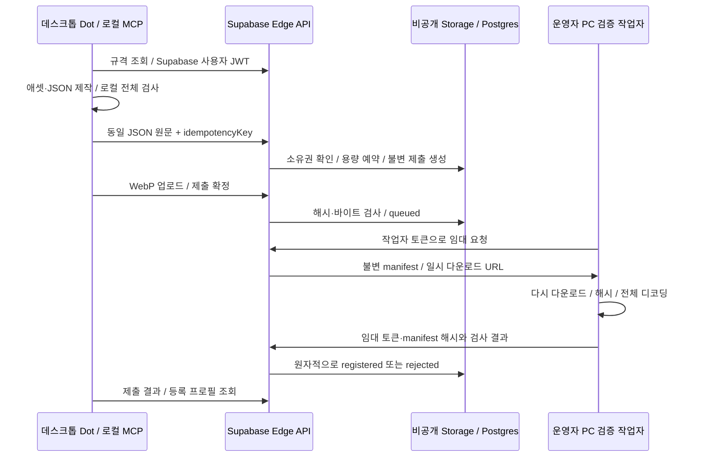

# Supabase Free 베타 운영

v0.2는 초대된 사용자의 업로드 → 서버 파일 검사 → 선수 레지스트리 등록을 구현한다.
2026-10-19 기존 Free 프로젝트에서 실제 MCP로 예제 선수 1명을 등록했다.
등록은 데이터와 파일의 기술 검사 결과다. 새 등록은 runtimeApproved=false다.
운영자가 동일 manifest 해시의 플레이어 경기 범위를 승인하면 runtimeApproved=true와
runtimeScope=arena-player-v1을 반환한다. 승인된 Sparring Bot의 로컬 게임 출전을 확인했다.

## 구성과 상태



상태는 `uploading → queued → validating → registered | rejected`다.
업로드는 24시간 안에 끝낸다. 작업 임대는 5분이고, 중단된 작업은 최대 3회 시도한다.
같은 사용자·idempotencyKey·JSON 원문으로 재시도하면 기존 제출과 선수 ID를 반환한다.
같은 키에 다른 JSON을 보내면 409다. 수정한 패키지는 새 키로 제출한다.
사용자당 등록 선수는 1명이며 등록 후 교체 API는 아직 없다.

## 배포

원천 파일:

- [DB 마이그레이션](../supabase/migrations/20261019090136_ai_fighter_beta_registration.sql)
- [Edge 진입점](../supabase/functions/ai-fighter/index.ts), [공유 HTTP 처리기](../api/handler.mjs)
- [검증 작업자](../worker/run.mjs), [MCP 제출 도구](../mcp/remote-tools.mjs)

프로젝트 운영자만 마이그레이션을 적용한다. 새 테이블은 `af_` 접두사를 쓰고,
Storage bucket은 비공개 `ai-fighter-beta`다. 기존 게임 테이블·로그인·Storage 정책은 수정하지 않는다.
기존 프로젝트를 CLI에 연결할 때는 **그 프로젝트의 기존 마이그레이션 이력도 먼저 가져와 대조**한다.
이 샘플 하나만으로 기존 프로젝트에 `db reset` 또는 무검토 `db push`를 실행하지 않는다.

Supabase CLI에서 계정 로그인·프로젝트 선택 후:

```sh
supabase functions deploy ai-fighter --project-ref YOUR_PROJECT_REF --no-verify-jwt
```

`verify_jwt = false`는 공개 쓰기 허용을 뜻하지 않는다. 함수 내부에서 사용자 JWT를
Supabase Auth `getUser`로 검증하고 활성 초대를 매 요청 확인한다. 작업자는 별도 토큰으로 인증한다.
Edge의 내장 `SUPABASE_URL`과 `SUPABASE_SERVICE_ROLE_KEY`만 DB·Storage의 권한 있는 쓰기에 사용한다.
서비스 키를 Dot·브라우저·클라이언트 세션 파일에 전달하지 않는다.
API 기본 경로는 `https://YOUR_PROJECT_REF.supabase.co/functions/v1/ai-fighter`다.

## 승인과 게임 로딩

[두 번째 마이그레이션](../supabase/migrations/20261019093527_ai_fighter_arena_runtime.sql)은 승인 상태를
`runtime_scope`, `runtime_manifest_sha`, `review_evidence`에 결합한다. 승인에는 동일 manifest 해시,
`arena-player-v1` 범위, 승인 사유와 검증 근거가 필요하다. 클라이언트의 직접 수정 권한은 없다.
일반 제출·작업자 검증만으로 출전 승인 상태가 되지 않는다. `/spec`의 runtimeApproved=false는 새 등록의 기본값이다.

운영자는 기술 검사를 통과한 패키지의 실제 경기 재생을 확인하고 해당 해시에만 승인 상태를 기록한다.
현재 범위는 사람이 조종하는 캐릭터의 외형이다. 체력·피해량·판정은 게임의 공통 플레이어 규칙이 소유한다.
자동 전투 상대·랭킹 밸런스·새 그림의 상용 품질을 승인하는 범위가 아니다.

게임 연결 흐름:

1. GET /roster로 승인된 선수 ID·이름·해시를 받는다. 소유자·제출·임대 정보는 목록에 포함하지 않는다.
2. GET /roster/:id로 같은 해시의 JSON 원문과 일시 파일 URL을 받는다.
3. JSON 원문의 SHA-256과 규격을 검사하고, 파일을 내려받아 바이트 수와 SHA-256을 확인한다.
4. 목록에는 정지 동작만 먼저 받고, 입장 때 승인 상태를 다시 조회한 뒤 나머지 동작을 준비한다.
5. 서버 ID로 목록·경기·전적을 연결한다. 같은 ID는 목록에 한 번만 표시한다.

위 두 GET 경로만 브라우저의 공개 읽기를 허용한다. 브라우저에는 서비스 키나 사용자 세션을 넣지 않는다.
승인 패키지의 그림은 공개 전달 대상이다. 버킷 자체는 비공개이며 URL은 10분 뒤 만료된다.
승인 취소는 신규 전달·입장을 막지만 이미 내려받은 그림과 진행 중인 경기를 회수하지는 않는다.

현재 게임 개발 환경의 설정은 다음과 같다. 프로젝트 주소는 운영자가 자신의 주소로 바꾼다.

```dotenv
VITE_AI_FIGHTER_API_BASE=https://YOUR_PROJECT_REF.supabase.co/functions/v1/ai-fighter
```

이 값은 공개 API 주소다. 비밀 키가 아니다. 미설정 또는 통신 실패 시 기존 게임 선수는 계속 사용할 수 있다.
게임 구현은 원본 게임 저장소에 있으며, 이 공개 샘플은 전달 API·DB·MCP·검증 작업자를 제공한다.

## 베타 계정과 Dot 연결

이번 베타는 Supabase Auth의 사용자 세션을 사용한다. 기존 게임 계정 연결은 후속 구현이다.
운영자가 Auth에 존재하는 사용자 ID를 `af_creators`에 초대한다. 기본 만료는 30일이다.
공개 OAuth 설치·로그인 UI는 아직 없다. 완성된 원클릭 온보딩이라고 안내하지 않는다.

운영자가 준비한 **사용자 자신의** 세션을 다음 비공개 파일에 저장한다.
파일은 저장소 밖에 두고 해당 OS 계정만 읽을 수 있게 한다. 사용자에게 서비스 키를 발급하지 않는다.

```json
{
  "url": "https://YOUR_PROJECT_REF.supabase.co",
  "publishableKey": "YOUR_PROJECT_PUBLISHABLE_KEY",
  "accessToken": "USER_ACCESS_TOKEN",
  "refreshToken": "USER_REFRESH_TOKEN"
}
```

MCP는 만료된 세션을 갱신하고 같은 파일에 저장한다. 갱신이 취소되었으면 다시 로그인해야 한다.
검증용 두 계정과 작업자 토큰을 만드는 스크립트는
[provision-test-accounts.mjs](../scripts/provision-test-accounts.mjs)다.
이는 테스트 계정용 운영자 도구이며 일반 사용자 로그인 기능이 아니다.
운영자 환경 변수 `SUPABASE_URL`, `SUPABASE_SECRET_KEY`, `SUPABASE_PUBLISHABLE_KEY`,
`AI_FIGHTER_PRIVATE_DIR`가 필요하다. 출력 폴더는 새 폴더여야 하며 이 스크립트를 MCP에 연결하지 않는다.
Windows에서는 폴더의 상속 ACL도 제거하고 현재 OS 계정만 접근하도록 설정한다.

```powershell
$env:AI_FIGHTER_CLIENT_CONFIG = 'C:/private/ai-fighter/client.json'
node scripts/print-install.mjs
# 출력된 codex mcp add 명령 실행 후 새 로컬 대화를 연다.
```

Dot에서 첫 실제 등록:

> ai-fighter 규격을 읽고 examples/sparring-bot/fighter.json을 검사해줘.
> UUID 하나를 idempotencyKey로 정해서 submit_fighter_package로 제출해.
> 재시도할 때는 같은 키를 사용하고 get_fighter_submission으로 결과를 조회해.
> 등록되면 get_registered_fighter로 이름과 ID, 실제 경기 출전 승인 여부를 알려줘.

공식 MCP SDK의 stdio 연결과 실제 원격 쓰기는 시험했다. 사용자별 Dot 화면의 도구 노출은 자동 시험하지 않았다.
같은 호스트의 새 로컬 대화에서 도구가 보이지 않으면 앱을 다시 시작한다.
웹 ChatGPT용 공개 HTTP MCP·OAuth 배포는 이 로컬 연결과 별도다.

## API 계약

| 메서드·경로 | 인증 | 역할 |
| --- | --- | --- |
| GET /spec | 없음 | 서버 규격·베타 등록 가능 여부 |
| GET /roster | 없음 | 출전 승인된 선수의 ID·이름·해시·범위. 최대 20명 |
| GET /roster/:id | 없음 | 승인된 JSON 원문과 10분 만료 다운로드 URL |
| POST /submissions | 사용자 JWT + 초대 | JSON 원문 접수, UUID Idempotency-Key 헤더 필수 |
| PUT /submissions/:id/assets/:assetId | 소유자 | image/webp 바이너리, 선언 크기·해시 일치, 덮어쓰기 금지 |
| POST /submissions/:id/submit | 소유자 | 모든 파일 존재·크기 확인 후 검증 큐에 넣기 |
| GET /submissions/:id | 소유자 | 상태·오류·선수 ID 조회 |
| GET /fighters/:id | 소유자 | 등록 프로필·검토 상태 조회 |
| POST /worker/claim | 작업자 | 큐 임대·일시 다운로드 URL 발급 |
| POST /worker/finish | 작업자 | 동일 임대·manifest 해시로 검사 확정 |

오류는 `ok: false`, `code` 및 필요한 경우 `errors`를 반환한다.
주요 HTTP 상태: 인증 없음 401, 초대·작업자 권한 없음 403, 다른 소유자·없는 자료 404,
불변성·용량·상태 충돌 409, 본문 초과 413, 잘못된 파일 종류 415, 규격·해시 오류 422,
사용자 요청 한도 429, 일시 서비스 오류 503.

## 검증 작업자 실행

Edge Functions의 CPU·네이티브 모듈 제약 때문에 sharp 전체 디코딩은 기존 개발 PC가 수행한다.
운영자는 임의 32바이트 토큰에 `afw_`를 붙이고 SHA-256만 `af_workers.token_hash`에 저장한다.
실제 토큰은 다음 비공개 설정 파일에만 둔다. 기본 작업자 만료는 30일이다.

```json
{ "url": "https://YOUR_PROJECT_REF.supabase.co", "workerToken": "afw_YOUR_64_HEX_DIGITS" }
```

```powershell
$env:AI_FIGHTER_WORKER_CONFIG = 'C:/private/ai-fighter/worker.json'
npm run worker:once
# 계속 운영할 때:
npm run worker:watch
```

작업자는 사용자 MCP와 별도 프로세스로 운영한다. 빈 큐 조회는 최대 120초 간격으로 늦춘다.
결과가 즉시 나타나지 않을 수 있다. PC가 꺼지면 제출은 대기하며 자동 시작 설치는 포함하지 않는다.
항상 켜진 기존 실행 환경이 없다면 이 구성은 24시간 즉시 등록을 보장하지 않는다.
작업자 토큰은 큐를 검사·확정할 권한이다. 이를 Dot에 제공하지 않는다.

파일은 작업별 새 디렉터리에 다운로드한다. 해시·크기·전체 디코딩·프레임·crop을 다시 검사한다.
외부 URL 다운로드와 리디렉션은 허용하지 않는다. 자식 프로세스 검사 제한은 20초다.
V8 힙·픽셀 예산은 네이티브 메모리의 OS 강제 격리를 대신하지 않는다.
현재는 초대 베타이며 불특정 다수 공개 접수 전 OS 메모리·CPU 격리가 필요하다.

## 무료 운영 한도와 중단

앱 자체 상한은 활성 초대 20명, 사용자당 선수 1명·진행 중 제출 1개·누적 제출 5개,
패키지 10 MB, 단일 파일 4 MB, 사용자 요청 120회/분이다.
전체 제출 예약은 **100 MB**로 제한한다. 20명 모두 최대 10 MB를 제출할 수 있다는 보장은 아니다.
반려·만료 파일도 예약 용량에 포함한다. 기존 프로젝트의 다른 사용량은 별도 합산한다.

자동 파일 정리는 아직 없다. 업로드 만료 후에도 기록과 용량 예약이 유지되며 운영자가 정리해야 한다.
운영자는 `af_settings.paused`로 새 제출을 멈추고, 초대·작업자 `enabled`로 접근을 취소할 수 있다.
정리할 때 업로드·작업자가 진행 중인지 확인하고 Storage 객체와 예약 기록을 함께 처리한다.
Storage 객체를 SQL로만 삭제하지 않는다. 등록된 제출은 선수의 참조 원천이므로 보존한다.

2026-10-19 확인한 Free 포함량은 DB 500 MB/프로젝트, 파일 저장 1 GB,
일반 전송 5 GB와 캐시 전송 5 GB/월, Edge 호출 500,000회/월이다.
[공식 가격표](https://supabase.com/pricing)와 [과금 범위](https://supabase.com/docs/guides/platform/billing-on-supabase)를 운영 시 확인한다.
[Edge 실행 제한](https://supabase.com/docs/guides/functions/limits) 때문에 서버 디코더를 PC로 분리했다.
이미지 생성 도구 요금·PC 전력·인터넷은 Supabase 무료 사용량과 별개다. 유료 전환은 자동화하지 않는다.
[유출 비밀번호 차단은 Pro 이상](https://supabase.com/docs/guides/auth/password-security)이며 이 Free 테스트에서는 켜지 않았다.
테스트 계정은 무작위 긴 비밀번호를 사용하고 세션 발급 후 비밀번호를 보관하지 않았다.

## 검증 기록

로컬 테스트는 `npm test`, 계약 동기화는 `npm run spec:check`다.
DB 테스트는 실제 PostgreSQL 엔진 PGlite에서 마이그레이션·RLS·임대·트랜잭션을 검사한다.
실제 원격 쓰기 테스트는 명시적으로만 실행한다. 테스트용 초대 계정 두 개와 작업자 설정이 필요하다.

```powershell
$env:AI_FIGHTER_PRIVATE_DIR = 'C:/private/ai-fighter'
npm run test:live
```

2026-10-19 실제 Free 프로젝트에서 통과한 10개 항목:

1. 공식 SDK로 실제 stdio MCP 초기화·도구 조회·서버 규격 읽기.
2. 익명 등록 401.
3. 잘못된 스키마·중복 JSON 키 422, 과도한 JSON 413.
4. MCP가 11개 WebP 파일을 실제 업로드하고 제출.
5. 동시에 보낸 생성 재시도 4개가 같은 제출 ID 반환. 같은 키의 변경 JSON은 409.
6. 다른 계정 조회·업로드 404. 제작자 토큰으로 작업자 승인 시도 403.
7. 별도 작업자가 저장 파일을 다시 다운로드·전체 디코딩하고 선수 1명 등록.
8. 같은 MCP 제출 재시도는 기존 선수 ID 반환. 확정 파일 덮어쓰기 409.
9. DB RLS에서 다른 계정의 행은 보이지 않음. 클라이언트 직접 등록 INSERT는 403.
10. 로컬 검사를 우회해 **해시는 맞지만 손상된 WebP**를 보내도 서버가 반려하고 선수 ID를 만들지 않음.

성공 선수의 파일 합계는 173,040바이트다. 이는 자체 제작 형식 시험용 로봇이며 생성 모델의 동작 품질 증거가 아니다.
이 실행은 DB 등록까지 검증했다. 새 생성 애셋의 전투 시연, 게임 계정 연결, 최대 크기 부하,
OS 격리, 자동 정리·복구 운영은 후속 검증이다.

이후 같은 패키지를 `arena-player-v1`로 승인하여 로컬 게임에서 목록·선택·입장·조작·피해·KO 승리까지 시험했다.
결과는 서버 선수 ID로 한 번만 저장됐고 새로고침 후 유지됐다. 공개 샘플 시험은 승인·전달 경계를 포함해 33개 통과했다.
배포 후 읽기 전용 검증은 아래처럼 실행한다. 소유자의 `AI_FIGHTER_CLIENT_CONFIG`도 지정하면
실제 stdio MCP의 선수 조회·제출 조회가 같은 승인 상태를 반환하는지 함께 확인한다.

```powershell
$env:AI_FIGHTER_API_BASE = 'https://YOUR_PROJECT_REF.supabase.co/functions/v1/ai-fighter'
$env:AI_FIGHTER_TEST_ID = 'APPROVED_FIGHTER_UUID'
node scripts/live-roster-test.mjs
```

이 시험은 공개 목록, 동일 해시의 JSON, 필수 파일 11개의 실제 바이트·해시와 MCP 승인 조회를 통과했다.
