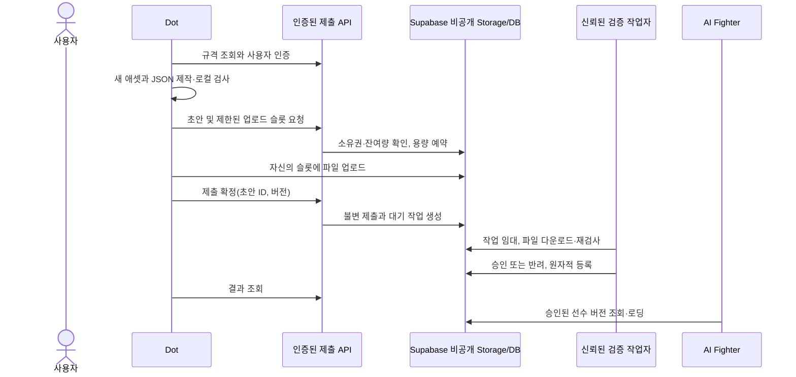

# Supabase 무료 베타 — 후속 구현 계약

이 저장소는 Supabase 리소스를 생성하거나 기존 프로젝트를 변경하지 않는다.
아래는 구현해야 할 서버 경계다. SQL·Edge 배포·등록 API는 아직 포함하지 않았다.

## 구현 규칙

- 사용자 인증 결과에서 owner를 정한다. 클라이언트 JSON의 owner·approved·HP를 신뢰하지 않는다.
- 기존 게임 계정 연결을 유지한다. Supabase 계정으로 자동 대체하지 않는다.
- RLS로 소유자별 초안 접근을 제한한다. 서비스 키는 서버 작업자에만 보관한다.
- 업로드 전 사용자별·조직별 남은 용량을 예약한다. 파일 수, 실제 바이트, TTL과 제출 횟수를 제한한다.
- 사용자가 수정할 수 있는 업로드 슬롯을 그대로 승인하지 않는다. 확정 시 불변 객체/버전으로 봉인한다.
  검증 결과는 정확한 제출 버전·manifest 해시·파일 해시 집합에 결합한다.
- `(owner_id, draft_id)` 등록 고유 제약과 트랜잭션을 사용한다. 같은 초안의 재시도는 기존 ID를 반환한다.
  ID 조회 후 INSERT만 하는 방식은 동시 요청에서 중복을 만든다.
- 작업 임대, 만료 후 재시도, 검증 버전, 실패 사유를 저장한다. PC가 꺼지면 검증 대기 상태를 유지한다.
- 등록된 선수 ID·버전을 게임에서 다시 중복 제거한다. DB 등록 한 번과 화면 배치 한 번은 별개다.
- 단순 투명 픽셀 하나만으로 배경 제거·애니메이션 품질을 승인하지 않는다. 시각·런타임 검수가 필요하다.

## 무료 플랜의 현실적인 경계

2026-10-19 확인 기준 Free 포함량은 DB 500 MB/프로젝트, 파일 저장 1 GB,
일반 전송 5 GB와 캐시 전송 5 GB/월, Edge Functions 500,000회/월이다.
실제 잔여량과 다른 기능의 사용량을 함께 계산한다.
요금·할당량은 [공식 가격표](https://supabase.com/pricing)와
[과금 범위](https://supabase.com/docs/guides/platform/billing-on-supabase)를 배포 전에 재확인한다.

Edge Functions는 메모리 256 MB, CPU 2초 제약이 있으며 이 샘플의 네이티브 `sharp` 작업자를 그대로 배포할 수 없다.
출처: [Edge 실행 제한](https://supabase.com/docs/guides/functions/limits).
첫 베타는 기존 개발 PC에서 서버 검증 작업자를 실행하는 방안이 가능하다.
PC가 꺼지면 검증이 늦어지고 운영 비용·가용성은 Supabase 무료 플랜과 별개다.

예를 들어 활성 선수 20명 × 10 MB = 200 MB다. 같은 수의 제출 대기본도 200 MB를 쓴다.
파일 보관 기간과 동시 업로드를 제한해야 한다. 한도에 도달하면 새 제출을 중단한다.
이 계산은 무제한 무료 운영이나 즉시 등록을 보장하지 않는다.
